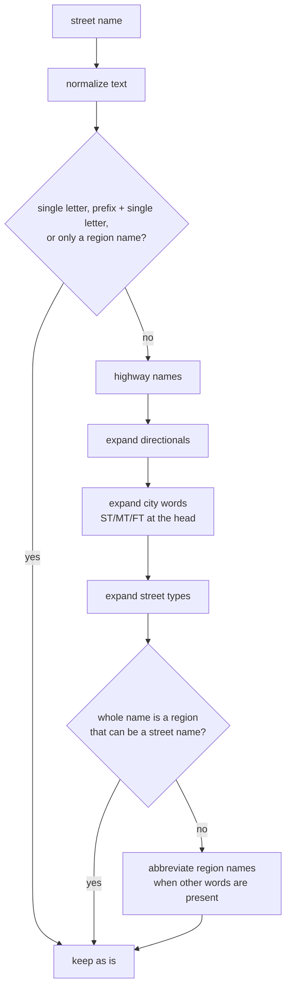

# Where the standards are insufficient, and what we decided

Project US@ is built on USPS Publication 28. Both are silent, ambiguous or
self-contradictory in places, and a reference implementation has to pick an
answer anyway. This document collects those places and the decision made at
each, so users know what to expect and so the gaps can inform a future revision
of the standard.

Every entry also lives as a comment at the code site, as
[CONTRIBUTING §2](../CONTRIBUTING.md) requires. If this page and the code
disagree, the code is right; please fix the page.

Status is **decided** (ruled on in the linked issue or recorded in code) or
**open** (under discussion; current behavior may change).

## 1. The standard contradicts itself

| Where | Problem | Decision | Status |
| --- | --- | --- | --- |
| p.33 business example | Prints last line `KRYTON, TN 38188-0022` from input ZIP+4 `38188-0002`; the p.34 example of the same address prints `KRYTON TN 38188-0002`. | Follow p.34. | decided (`pkg/address/parser/parsertest/spec.go`) |
| p.30 HC table | Row `HC 03 Bzn 1050` prints `HC 1 BOX 1050`, but the rule directly above forbids leading zeros, which gives `HC 3`. The printed `1` is copied from the row above. | Follow the rule, not the example: `HC 3 BOX 1050`. | decided, [#119](https://github.com/PortobelloAuth/go-projectusat/issues/119) |
| p.26 `CALLE 191 B113` | Prints `13 CALLE 191` with no reason to drop the `B1`. | Follow the Pub 28 Puerto Rico page (pub28c2_045), which corrects it to `B113 CALLE 191`. | decided (`spec.go`) |

## 2. The standard's examples contradict Pub 28

| Where | Problem | Decision | Status |
| --- | --- | --- | --- |
| p.16-17 directional examples | `N BAY STREET`, `BAY DRIVE W`, `BAY WEST DRIVE` leave the suffix spelled out, against the rule to abbreviate suffixes. | Follow Pub 28's corrected examples: `N BAY ST`, `BAY DR W`, `BAY WEST DR`. | decided (`spec.go`) |
| p.35 `PIZZA DELIVERY COMPANY` | Example keeps `COMPANY`; Pub 28 Appendix G has a real `COMPANY -> CO` row. | Hold to the real table: `PIZZA DELIVERY CO`. | decided, [#157](https://github.com/PortobelloAuth/go-projectusat/issues/157) |

## 3. The standard is silent

| Topic | Problem | Decision | Status |
| --- | --- | --- | --- |
| Spellings that become `HC` | No list is given, and silence is not a statement that the list is empty. | Mirror the rural-route spellings, plus `STAR ROUTE` on Pub 28 §253's authority. | decided (`pkg/addresstypes/ruralroute`) |
| Appendix G business words | Appendix G mixes legal-entity suffixes (`INCORPORATED`, `COMPANY`) with ordinary words that double as entries (`BUSINESS -> BUS`, `PIZZA -> PZ`). Scanning the whole name wrecks the second kind. | Abbreviate only trailing words, longest window first. | decided, [#157](https://github.com/PortobelloAuth/go-projectusat/issues/157) (`normalizer.AbbreviateBusinessWords`) |
| `GEN DEL` and half-spelled variants | The MUST governs what a record holds, not what an intake system was sent. | Accept `GEN DEL`-style spellings on input, never produce them. `ENTREGA GENERAL` is left out because the Puerto Rico vocabulary is one table. | decided (`pkg/addresstypes/generaldelivery`) |
| Missing ZIP / `-9999` on general delivery | The ZIP is a MUST about a well-formed record, but the package is a recognizer, not a validator. | Do not refuse an address for a missing ZIP; that is the caller's question to ask. | decided (`generaldelivery`) |
| Spanish directionals in Puerto Rico | "MUST NOT translate directionals" (p.25), yet `NOROESTE` has to abbreviate somehow. | Spelled-out Spanish directionals abbreviate to the Spanish form (`NO`, `SO`); never translate to English. | decided, [#154](https://github.com/PortobelloAuth/go-projectusat/issues/154) |
| Plural and singular street suffixes sharing one abbreviation | Two distinct primary suffixes can abbreviate identically, so abbreviating loses information and the standard offers no distinct abbreviations. | Content form abbreviates; exchange (matching) form treats both primaries as potential matches. We do not invent abbreviations. See the README. | decided |

## 4. `#` and other tokens that mean more than one thing

| Token | Readings | Decision | Status |
| --- | --- | --- | --- |
| `#` | Secondary unit of unspecified type (Pub 28 §213.2), PMB (§285), `BOX` on a rural route. | Without other evidence it is a secondary unit ([#78](https://github.com/PortobelloAuth/go-projectusat/issues/78)). `pkg/privatemailbox` claims the `#` form below that, and an address type with a secondary unit already on the line decides. Output is always `PMB` ([#76](https://github.com/PortobelloAuth/go-projectusat/issues/76)). | decided |
| `FM` | Texas Farm-to-Market road or Federated States of Micronesia. | Never read as a state in a highway name. | decided (`pkg/highways`) |

## 5. Ambiguous street-name abbreviations

`CT`, `MT`, `NE`, `ST` and similar are several things at once: a region, a
directional, a city word, a street suffix.

| Abbreviation | Readings |
| --- | --- |
| `MT` | `MONTANA`, `MOUNT` |
| `NE` | `NEBRASKA`, `NORTHEAST` |
| `ST` | `SAINT`, `STREET`, `STATE` |
| `CT` | `CONNECTICUT`, `COURT` |

`NormalizeStreetName` applies its steps in a fixed order, and the order is the
decision (`pkg/address/normalizer/normalizerfn.go`). Region abbreviation runs
last so that its output is never handed to a step that might reinterpret it:
`NEBRASKA` must not become `NORTHEAST`, and `MONTANA TREASURE AVENUE` must
settle on `MT TREASURE AVE` rather than round-trip to `MOUNT TREASURE AVE`
([#165](https://github.com/PortobelloAuth/go-projectusat/issues/165)). The
city-word step reads a head-position `ST`/`STE`/`MT`/`FT` as
`SAINT`/`SAINTE`/`MOUNT`/`FORT`
([#114](https://github.com/PortobelloAuth/go-projectusat/issues/114)).

**Open:** a street name such as `CT AVENUE`, read in a single-line address with
no last line to confirm it against data, is genuinely ambiguous. The direction
under discussion ([#235](https://github.com/PortobelloAuth/go-projectusat/issues/235),
[#242](https://github.com/PortobelloAuth/go-projectusat/pull/242)) is to
prefer the region abbreviation where other street-name parts exist, and to
disambiguate by data whenever data is available. A name such as
`CONNECTICUT AVENUE` should not reach this point as `CT AVENUE` at all, because
`AVENUE` is the suffix. This section will be updated when the rule is settled.
